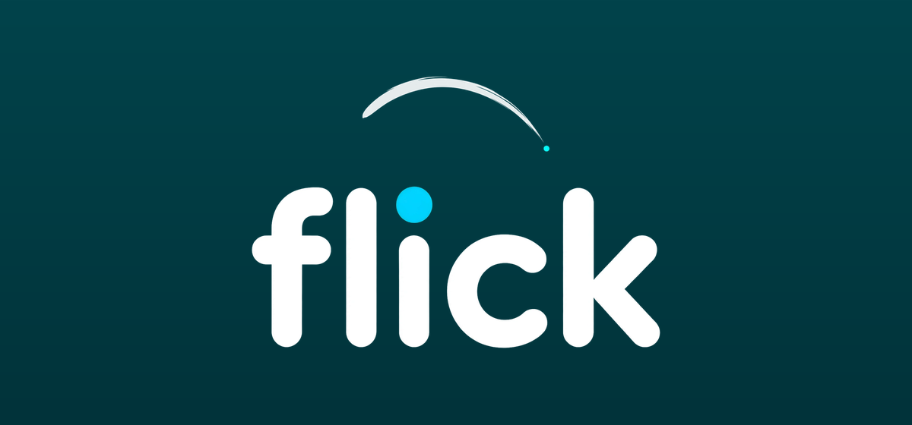

<p align="center">
  
</p>

<p align="center">
  <b>✨ Draw a gesture. Launch anything. 🚀</b><br>
  Flick is a fully local Android app: no backend, no accounts,
  no data leaves your phone. 🔒
</p>

<p align="center">
  
  
  
  
</p>

## ⬇️ Download

<p align="center">
  <a href="https://github.com/ibfavas/Flick/releases/download/v1.4.0/flick-1.4.0.apk">
    
  </a>
</p>

<p align="center">
  📦 <a href="https://github.com/ibfavas/Flick/releases">All releases</a>
</p>

## 🎉 What is new in 1.4.0

✏️ The home screen got a sketchbook look. Gesture cards now have
hand-drawn frames, the heading and names are in a handwritten font,
and small doodles are scattered around. Nothing else changed. 👍

## ✨ Features

- **🎨 Gesture pad:** draw a gesture on a full screen canvas. Flick
  recognises it with a matcher written from scratch (a multi-stroke $N
  recognizer blended with banded DTW, direction handling, and a rescue
  pass for draws cut short). Sloppy, tilted, and reversed strokes still
  match, and near misses do not launch the wrong thing. Draw a circle,
  lift, and draw a line to make a Q ✍️. Multi-stroke gestures work, and
  single-stroke gestures work exactly as before. No ML model, no
  dependency.
- **📚 Gesture library:** record gestures, give them names, attach
  actions, edit, delete, enable or disable, and test them from the draw
  pad. Up to 3 samples per gesture, with a confidence readout while
  testing. Add extra samples straight from the gesture sheet. Everything
  is stored locally in a SQLite database on the phone 💾. Backup and
  restore your gestures as JSON.
- **⚡ Actions:** launch an app, open a URL or deep link, call a
  contact 📞, lock the screen, take a screenshot, toggle flashlight,
  open the camera, play or pause media, open Wi-Fi or Bluetooth settings,
  and toggle Do Not Disturb.
- **🔗 Flows:** chain several actions into one gesture ⛓️, run step by step.
- **👻 Invisible widget:** a fully transparent home screen widget. Tap
  it and a transparent gesture pad opens. Draw, and the matched action
  runs. Round and wide widget styles are available too.
- **⚙️ Quick Settings tile:** the Flick tile opens the same gesture pad
  from anywhere 📲.
- **🎨 Themes:** 🌑 AMOLED black theme with your choice of accent colour
  🌈: Cyan, Green, Amber, Purple, Pink, or Blue. Stroke colour and width
  are adjustable too.

## 👻 How the invisible widget works

Android widgets only support taps, not stroke tracking: a widget cannot
receive finger movement data. So the widget itself is just a transparent
tap target. Tapping it launches a transparent full screen activity, and
the drawing happens there. In daily use it feels like drawing on the home
screen, but the drawing technically happens in that transparent activity,
not inside the widget.

## 🛠️ Build

Requirements: JDK 17 and the Android SDK (platform-tools,
`platforms;android-35`, `build-tools;35.0.0`).

```sh
export ANDROID_HOME=$HOME/android-sdk
./gradlew assembleDebug
```

For a signed release build, pass the keystore details as Gradle
properties (never commit them):

```sh
./gradlew assembleRelease \
  -PflickStoreFile=$HOME/.config/flick/flick-release.keystore \
  -PflickStorePassword=... \
  -PflickKeyAlias=flick \
  -PflickKeyPassword=...
```

A daemon-free manual build is also available via
`tools/build-manual.sh` (kotlinc CLI + aapt2 + d8 + apksigner), which
produces a signed release APK at `build/flick-release.apk`.

## 💬 Feedback

Found a bug or have an idea? Open an issue on GitHub, I read them all. 🙌

## 🎨 Originality

Flick is 100% original code written for this project. It shares a concept
with other gesture launchers (draw to launch) but copies no code, assets,
branding, or resources from any other app.

## 📄 License

Flick is licensed under the Apache License 2.0. See [LICENSE](LICENSE)
for the full text.
